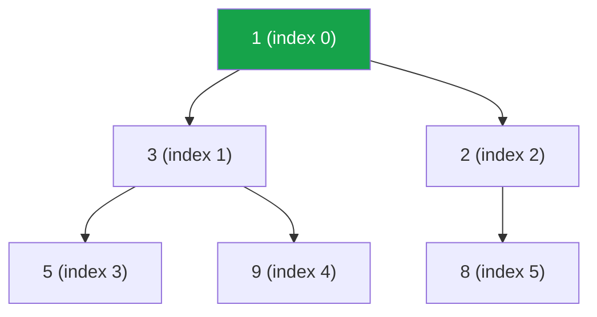

:::tip[TL;DR]
`PriorityQueue` is a **binary min-heap**: `poll()` always returns the smallest element in O(log n), `peek()` sees it in O(1). Pass `Collections.reverseOrder()` (or a comparator) for a max-heap. It is the engine behind top-K, Dijkstra, merge-K-sorted, scheduling and running-median problems.
:::

## Basics

```java showLineNumbers
PriorityQueue<Integer> pq = new PriorityQueue<>();     // MIN-heap by default
pq.add(10);
pq.add(5);
System.out.println(pq.poll());                         // 5  (smallest first)
```

| Method | Does | Time | Extra space |
| --- | --- | --- | --- |
| `offer(x)` / `add(x)` | insert | O(log n) (sift up; amortised for the array growth) | O(1) amortised |
| `peek()` | look at the min (`null` if empty) | **O(1)** | O(1) |
| `poll()` | remove + return the min (`null` if empty) | O(log n) (sift down) | O(1) |
| `size()`, `isEmpty()` | | O(1) | O(1) |
| `remove(x)` | remove a specific element | **O(n)** (linear search, then O(log n) fix-up) | O(1) |
| `contains(x)` | | **O(n)** | O(1) |
| `new PriorityQueue<>(collection)` | build a heap from existing items | **O(n)** (heapify) | O(n) |
| `addAll(collection)` / n × `offer` | | O(n log n) | O(n) |
| drain with n × `poll()` | get everything in order | O(n log n) | O(1) extra |
| iterate / `toString` / `toArray` | **not** in priority order | O(n) | O(n) for `toArray` |

A heap of n elements is **O(n) space**: one array, ~21 bytes per `Integer` element measured (4-byte reference + 16-byte `Integer`).

### Why offer and poll are O(log n)

A heap is a **complete binary tree**, so its height is ⌊log₂ n⌋. `offer` puts the new element at the bottom and swaps it **up** while it's smaller than its parent; `poll` moves the last element to the root and swaps it **down** toward the smaller child. Each walks at most one root-to-leaf path: O(log n). Building a heap from n items bottom-up (heapify) is O(n), not O(n log n), because most nodes are near the bottom and only move a little.

## What the Heap Looks Like Inside

```java showLineNumbers
PriorityQueue<Integer> mn = new PriorityQueue<>(List.of(5, 1, 8, 3, 9, 2));
System.out.println(mn);                // [1, 3, 2, 5, 9, 8]   ← NOT sorted
mn.peek();                             // 1
// draining with poll() gives sorted order: 1 2 3 5 8 9
```

The backing array is a **complete binary tree** stored level by level: the children of index `i` are `2i + 1` and `2i + 2`, the parent is `(i - 1) / 2`. Every parent is ≤ its children, which is all the heap promises.



:::danger[Printing or iterating a PriorityQueue is NOT sorted]
`System.out.println(pq)`, `for (int x : pq)` and `new ArrayList<>(pq)` show the raw array order (`[1, 3, 2, 5, 9, 8]`). Only repeated `poll()` gives elements in priority order.
:::

:::analogy[A heap is a hospital triage desk]
Patients don't stand in a sorted line. The desk only guarantees that whoever is called next is the most urgent one; the rest are roughly grouped, and the order is fixed up a little each time someone arrives or leaves.
:::

## Max-Heap

```java showLineNumbers
PriorityQueue<Integer> mx = new PriorityQueue<>(Collections.reverseOrder());
mx.addAll(List.of(5, 1, 8, 3));
mx.peek();                                              // 8

PriorityQueue<Integer> mx2 = new PriorityQueue<>((a, b) -> Integer.compare(b, a));  // same thing
PriorityQueue<Integer> mx3 = new PriorityQueue<>(Comparator.reverseOrder());          // same thing
```

:::danger[(a, b) -> b - a can overflow]
Subtraction comparators break when values are near `Integer.MIN_VALUE` / `MAX_VALUE`:

```java showLineNumbers
PriorityQueue<Integer> bad = new PriorityQueue<>((a, b) -> b - a);
bad.add(Integer.MIN_VALUE);
bad.add(1);
// error-next-line
bad.peek();                     // ❌ -2147483648  (1 - MIN_VALUE overflowed to negative)

PriorityQueue<Integer> good = new PriorityQueue<>((a, b) -> Integer.compare(b, a));
good.add(Integer.MIN_VALUE);
good.add(1);
// success-next-line
good.peek();                    // ✅ 1
```

`b - a` is fine when values are small (like array indices or counts), and you will see it everywhere. `Integer.compare` is always safe.
:::

## Heaps of Arrays, Pairs and Objects

Arrays aren't `Comparable`, so you **must** give a comparator.

```java showLineNumbers
// {node, distance}: order by distance
PriorityQueue<int[]> pa = new PriorityQueue<>((a, b) -> a[1] - b[1]);
pa.offer(new int[]{1, 9});
pa.offer(new int[]{2, 3});
pa.offer(new int[]{3, 5});
Arrays.toString(pa.poll());     // [2, 3]

// tie-break: by [1], then by [0]
PriorityQueue<int[]> pb = new PriorityQueue<>(
        Comparator.comparingInt((int[] a) -> a[1]).thenComparingInt(a -> a[0]));
pb.offer(new int[]{5, 2});
pb.offer(new int[]{1, 2});
Arrays.toString(pb.poll());     // [1, 2]
```

```java title="❌ No comparator for int[]" showLineNumbers
PriorityQueue<int[]> nc = new PriorityQueue<>();
// error-next-line
nc.add(new int[]{1});           // ❌ ClassCastException: class [I cannot be cast to class java.lang.Comparable
```

With records or your own classes:

```java showLineNumbers
record Task(String name, int pri) {}

PriorityQueue<Task> pt = new PriorityQueue<>(Comparator.comparingInt(Task::pri).reversed());
pt.add(new Task("a", 1));
pt.add(new Task("b", 3));
pt.poll();                      // Task[name=b, pri=3]  (highest priority first)
```

Strings use natural (alphabetical) order unless you say otherwise:

```java showLineNumbers
PriorityQueue<String> ps = new PriorityQueue<>(List.of("pear", "apple", "fig"));
ps.poll();                                              // "apple"
PriorityQueue<String> pl = new PriorityQueue<>((a, b) -> a.length() - b.length());
pl.addAll(List.of("pear", "apple", "fig"));
pl.poll();                                              // "fig"  (shortest)
```

## Patterns

### Top-K largest: keep a min-heap of size K

The heap holds the K biggest seen so far; its top is the **K-th largest**. O(n log k) time, O(k) space.

```java showLineNumbers
int[] nums = {3, 2, 1, 5, 6, 4};
int k = 2;
PriorityQueue<Integer> h = new PriorityQueue<>();      // MIN-heap for the K LARGEST
for (int n : nums) {
    h.offer(n);
    // highlight-next-line
    if (h.size() > k) h.poll();                        // evict the smallest
}
h.peek();                                              // 5  → 2nd largest
```

| Want | Heap to keep |
| --- | --- |
| K largest / K-th largest | **min**-heap of size K |
| K smallest / K-th smallest | **max**-heap of size K |
| K closest points | max-heap by distance, size K |

### Top-K frequent: heap of map entries

```java showLineNumbers
int[] f = {1, 1, 1, 2, 2, 3};
Map<Integer, Integer> cnt = new HashMap<>();
for (int v : f) cnt.merge(v, 1, Integer::sum);         // {1=3, 2=2, 3=1}

PriorityQueue<Map.Entry<Integer, Integer>> e =
        new PriorityQueue<>((a, b) -> a.getValue() - b.getValue());   // min by count
for (Map.Entry<Integer, Integer> en : cnt.entrySet()) {
    e.offer(en);
    if (e.size() > 2) e.poll();
}
// polling gives [2, 1] (least frequent of the top 2 first)
```

Counting is O(n); the heap phase is O(u log k) for u distinct values; total **O(n + u log k) time, O(u + k) space**. Bucket sort by frequency (an array of lists indexed by count) gets **O(n)** time.

### Top-K: which approach?

| Approach | Time | Space | Notes |
| --- | --- | --- | --- |
| Sort everything, take k | O(n log n) | O(1) to O(n) | simplest; fine when n is small |
| **Min-heap of size k** | **O(n log k)** | **O(k)** | works on a stream; the usual interview answer |
| Max-heap of all n, poll k times | O(n + k log n) | O(n) | heapify is O(n) |
| Quickselect | O(n) average, O(n²) worst | O(1) | randomise the pivot; modifies the array |
| Counting / bucket (small value range or frequencies) | O(n + range) | O(range) | Top K Frequent in O(n) |

### Dijkstra's shortest path

```java title="Dijkstra.java" showLineNumbers
// graph.get(u) holds {v, weight} edges
int[] dist = new int[n];
Arrays.fill(dist, Integer.MAX_VALUE);
dist[src] = 0;
PriorityQueue<int[]> q = new PriorityQueue<>((a, b) -> Integer.compare(a[1], b[1]));  // {node, dist}
q.offer(new int[]{src, 0});
while (!q.isEmpty()) {
    int[] cur = q.poll();
    int u = cur[0], du = cur[1];
    // highlight-next-line
    if (du > dist[u]) continue;                        // stale entry: skip (lazy deletion)
    for (int[] ed : graph.get(u)) {
        int v = ed[0], w = ed[1];
        if (du + w < dist[v]) {
            dist[v] = du + w;
            q.offer(new int[]{v, dist[v]});
        }
    }
}
// edges 0→1(4), 0→2(1), 2→1(2), 1→3(1), 2→3(5) from 0 → dist = [0, 3, 1, 4]
```

Java's `PriorityQueue` has no "decrease key", so you push a new entry and skip outdated ones when they come out. Removing the old entry with `remove(x)` would cost O(n).

**O((V + E) log V) time** (each edge can push one entry, each push/poll is O(log E) = O(log V)), **O(V + E) space** (adjacency list + up to E heap entries). It needs non-negative weights; with negative edges use Bellman-Ford (O(V · E)).

### Merge K sorted lists

```java showLineNumbers
int[][] lists = {{1, 4, 5}, {1, 3, 4}, {2, 6}};
PriorityQueue<int[]> mk = new PriorityQueue<>((a, b) -> Integer.compare(a[0], b[0]));  // {value, listIdx, elemIdx}
for (int i = 0; i < lists.length; i++) mk.offer(new int[]{lists[i][0], i, 0});
List<Integer> merged = new ArrayList<>();
while (!mk.isEmpty()) {
    int[] c = mk.poll();
    merged.add(c[0]);
    if (c[2] + 1 < lists[c[1]].length) mk.offer(new int[]{lists[c[1]][c[2] + 1], c[1], c[2] + 1});
}
// [1, 1, 2, 3, 4, 4, 5, 6]
```

With N total elements across k lists: the heap never holds more than k entries, so **O(N log k) time, O(k) extra space** (plus O(N) for the output). Merging lists pairwise one after another would be O(N · k).

### Running median: two heaps

`lo` is a max-heap with the smaller half, `hi` a min-heap with the larger half; keep `lo` the same size as `hi` or one bigger.

```java showLineNumbers
PriorityQueue<Integer> lo = new PriorityQueue<>(Collections.reverseOrder());
PriorityQueue<Integer> hi = new PriorityQueue<>();

void add(int v) {
    lo.offer(v);
    hi.offer(lo.poll());                               // move lo's biggest to hi
    if (hi.size() > lo.size()) lo.offer(hi.poll());    // rebalance
}
double median() {
    return lo.size() > hi.size() ? lo.peek() : (lo.peek() + hi.peek()) / 2.0;
}
// adding 5, 15, 1, 3 → medians 5.0, 10.0, 5.0, 4.0
```

`add` is **O(log n)** (a constant number of heap operations), `median` is **O(1)**, and the two heaps take **O(n) space**. Re-sorting after every insert would cost O(n log n) per median.

## Pattern Complexity Summary

| Pattern | Time | Space |
| --- | --- | --- |
| K-th largest / Top-K with a size-k heap | O(n log k) | O(k) |
| Top-K frequent (count + heap) | O(n + u log k) | O(u + k) |
| Merge K sorted lists / arrays | O(N log k) | O(k) |
| Dijkstra | O((V + E) log V) | O(V + E) |
| Running median (two heaps) | O(log n) add, O(1) query | O(n) |
| Task scheduling / meeting rooms (heap of end times) | O(n log n) | O(n) |
| Heap sort | O(n log n) | O(1) (in-place array version) |

## Gotchas

- `PriorityQueue` rejects `null` (`NullPointerException`); `poll()` / `peek()` on an empty heap return `null`, and unboxing that into an `int` throws.
- It is **not** thread-safe. The concurrent version is `PriorityBlockingQueue`.
- Changing a field of an object that is already in the heap does **not** re-order it. Remove it, change it, re-add it (or push a new copy and skip stale ones, as in Dijkstra).
- Ties come out in no particular order: `PriorityQueue` is not stable. Add a tie-breaker to the comparator if the problem specifies one (e.g. "if equal frequency, alphabetical").
- To sort with a heap ("heap sort"), poll n times: O(n log n). For plain sorting, `Arrays.sort` / `Collections.sort` is simpler and faster.
