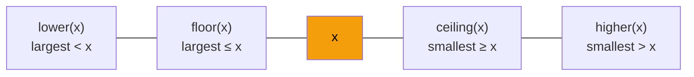

:::tip[TL;DR]
`TreeSet` and `TreeMap` keep their elements **sorted at all times** (a red-black tree inside), with O(log n) add / remove / search. Their superpower is **navigation**: `floor`, `ceiling`, `lower`, `higher`, `first`, `last` and range views (`headMap`, `tailMap`, `subMap`). Reach for them when a problem says "closest", "next bigger", "smallest greater than", "intervals" or "sorted order while inserting".
:::

## Basics

```java showLineNumbers
Set<String> ts = new TreeSet<>();
ts.add("Dog");
ts.add("Cat");
System.out.println(ts);                 // [Cat, Dog]  (sorted, not insertion order)

Map<String, Integer> tm = new TreeMap<>();
tm.put("Orange", 5);
tm.put("Mango", 15);
System.out.println(tm);                 // {Mango=15, Orange=5}  (sorted by KEY)
```

| | `HashSet` / `HashMap` | `TreeSet` / `TreeMap` |
| --- | --- | --- |
| Inside | hash table | red-black tree (self-balancing BST) |
| add / remove / contains | **O(1)** average | O(log n) |
| Order | none | **sorted** (natural or comparator) |
| Min / max | O(n) scan | `first()` / `last()` in O(log n) |
| Nearest element | not possible | `floor`, `ceiling`, `lower`, `higher` |
| Key needs | `equals` + `hashCode` | `Comparable` or a `Comparator` |
| `null` key | allowed | `NullPointerException` |

Declare the variable as `TreeSet` / `TreeMap` (or `NavigableSet` / `NavigableMap`), not `Set` / `Map`, otherwise the navigation methods are hidden.

## Navigation Methods

Think of the sorted elements on a number line and ask "which neighbour do I want?".



```java showLineNumbers
TreeSet<Integer> s = new TreeSet<>(List.of(10, 20, 30, 40));
s.first();          // 10
s.last();           // 40
s.floor(25);        // 20    largest ≤ 25
s.floor(20);        // 20    (equal counts)
s.ceiling(25);      // 30    smallest ≥ 25
s.lower(20);        // 10    strictly less
s.higher(20);       // 30    strictly greater
// highlight-start
s.floor(5);         // null  nothing ≤ 5
s.ceiling(45);      // null  nothing ≥ 45
// highlight-end
```

| Method | Returns | `null` when |
| --- | --- | --- |
| `floor(x)` | largest element **≤ x** | all elements > x |
| `ceiling(x)` | smallest element **≥ x** | all elements < x |
| `lower(x)` | largest element **< x** | all elements ≥ x |
| `higher(x)` | smallest element **> x** | all elements ≤ x |
| `first()` / `last()` | min / max | never: **throws** `NoSuchElementException` if empty |
| `pollFirst()` / `pollLast()` | remove + return min / max | empty set |

For `TreeMap` the same methods exist with `Key` and `Entry` versions: `floorKey`, `floorEntry`, `ceilingKey`, `ceilingEntry`, `lowerKey`, `higherKey`, `firstKey`, `lastKey`, `firstEntry`, `lastEntry`, `pollFirstEntry`, `pollLastEntry`.

```java showLineNumbers
TreeMap<Integer, String> m = new TreeMap<>(Map.of(10, "a", 20, "b", 30, "c"));
m.firstKey();           // 10
m.lastKey();            // 30
m.floorKey(25);         // 20
m.ceilingKey(25);       // 30
m.lowerKey(10);         // null
m.floorEntry(25);       // 20=b   (key AND value)
m.firstEntry().getValue();  // "a"
m.pollFirstEntry();     // 10=a   (removes it)
```

:::warning[Use Integer, not int, for the result]
`int f = set.floor(x);` throws `NullPointerException` when there is no floor. Store it in an `Integer` and null-check:

```java showLineNumbers
Integer fl = win.floor(6), ce = win.ceiling(6);     // {1, 5, 9} → 5 and 9
if (fl != null && 6 - fl <= k) { /* close enough */ }
```
:::

## Range Views

```java showLineNumbers
TreeSet<Integer> s = new TreeSet<>(List.of(10, 20, 30, 40));
s.headSet(30);              // [10, 20]          < 30
s.headSet(30, true);        // [10, 20, 30]      ≤ 30
s.tailSet(20);              // [20, 30, 40]      ≥ 20
s.tailSet(20, false);       // [30, 40]          > 20
s.subSet(15, 35);           // [20, 30]          [15, 35)
s.descendingSet();          // [40, 30, 20, 10]

TreeMap<Integer, String> m = new TreeMap<>(Map.of(10, "a", 20, "b", 30, "c"));
m.headMap(20);              // {10=a}
m.tailMap(20);              // {20=b, 30=c}
m.subMap(10, 30);           // {10=a, 20=b}
m.descendingMap();          // {30=c, 20=b, 10=a}
m.descendingKeySet();       // [30, 20, 10]
```

These are **live views**, not copies. Getting the view is O(log n), but `.size()` on it walks the elements (O(k)), so `s.headSet(x).size()` is not an O(log n) "count smaller" query. For rank queries, use a Fenwick tree or a sorted array with binary search.

## Custom Order

```java showLineNumbers
TreeSet<Integer> d = new TreeSet<>(Collections.reverseOrder());
d.addAll(List.of(1, 5, 3));
d;                      // [5, 3, 1]
d.first();              // 5
// highlight-next-line
d.ceiling(4);           // 3  ← "ceiling" follows the COMPARATOR's order, so here it goes downward

TreeMap<String, Integer> ci = new TreeMap<>(String.CASE_INSENSITIVE_ORDER);
ci.put("b", 1); ci.put("A", 2); ci.put("a", 3);
ci;                     // {A=3, b=1}  ("a" counted as the same key as "A")
```

:::danger[The comparator decides what counts as a duplicate]
A `TreeSet`/`TreeMap` never calls `equals`. If the comparator returns `0`, the two elements are **the same** and the second one is dropped.

```java showLineNumbers
TreeSet<int[]> bad = new TreeSet<>((a, b) -> a[0] - b[0]);     // compares only a[0]
bad.add(new int[]{1, 100});
bad.add(new int[]{1, 200});
// error-next-line
bad.size();                                                    // ❌ 1  (second one silently lost)

// success-start
TreeSet<int[]> good = new TreeSet<>((a, b) -> a[0] != b[0]
        ? Integer.compare(a[0], b[0])
        : Integer.compare(a[1], b[1]));                        // ✅ tie-break on another field
// success-end
good.size();                                                   // 2
```
A common trick is to tie-break on a unique index: store `{value, index}`.
:::

## Patterns

### Multiset (sorted counts with duplicates)

Java has no `TreeMultiset`. A `TreeMap<value, count>` does the job: `firstKey()` / `lastKey()` give the current min / max even as values come and go (sliding-window min/max, "max − min ≤ limit" problems).

```java showLineNumbers
TreeMap<Integer, Integer> ms = new TreeMap<>();
for (int v : new int[]{5, 1, 5, 3}) ms.merge(v, 1, Integer::sum);
ms;                     // {1=1, 3=1, 5=2}
ms.firstKey();          // 1  current min
ms.lastKey();           // 5  current max

// remove one occurrence of 5, deleting the key when its count reaches 0
// highlight-next-line
ms.merge(5, -1, (a, b) -> a + b == 0 ? null : a + b);
```

### Interval booking (no overlaps)

```java showLineNumbers
// start → end of each booked interval [start, end)
boolean book(TreeMap<Integer, Integer> cal, int st, int en) {
    Map.Entry<Integer, Integer> prev = cal.floorEntry(st);     // interval starting at or before st
    Integer next = cal.ceilingKey(st);                         // next interval start
    if (prev != null && prev.getValue() > st) return false;    // prev runs into us
    if (next != null && next < en) return false;               // we run into next
    cal.put(st, en);
    return true;
}
// book(10, 20) → true, book(15, 25) → false, book(20, 30) → true
```

### Sweep line (max overlapping intervals)

`TreeMap` iterates keys in order, so it doubles as a sorted difference array.

```java showLineNumbers
int[][] iv = {{0, 30}, {5, 10}, {15, 20}};
TreeMap<Integer, Integer> diff = new TreeMap<>();
for (int[] i : iv) {
    diff.merge(i[0], 1, Integer::sum);          // a meeting starts
    diff.merge(i[1], -1, Integer::sum);         // a meeting ends
}
int cur = 0, best = 0;
for (int d : diff.values()) { cur += d; best = Math.max(best, cur); }
// best = 2 rooms;  diff = {0=1, 5=1, 10=-1, 15=1, 20=-1, 30=-1}
```

## When to Pick Which

| Problem says… | Use |
| --- | --- |
| "just check membership / count" | `HashSet` / `HashMap` |
| "output in sorted order" | `TreeMap`, or `HashMap` + sort once at the end (often faster) |
| "closest value", "smallest ≥ x", "predecessor / successor" | `TreeSet` / `TreeMap` |
| "keep min and max while inserting and deleting arbitrary values" | `TreeMap<value, count>` |
| "only ever need the min (or max)" | `PriorityQueue` (simpler, faster) |
| "insertion order" | `LinkedHashMap` / `LinkedHashSet` |

## Gotchas

- `first()`, `last()`, `firstKey()`, `lastKey()` **throw** on an empty collection; `pollFirst()`, `firstEntry()`, `floor()` and friends return `null`.
- Keys must be `Comparable` (Integer, String, records that implement `Comparable`...) or you must pass a comparator; otherwise you get a `ClassCastException` on the first `add`.
- Don't mutate a key's compared fields while it is inside a tree: it will be in the wrong place and lookups will miss it.
- `TreeMap.containsValue` is O(n) just like `HashMap.containsValue`.
