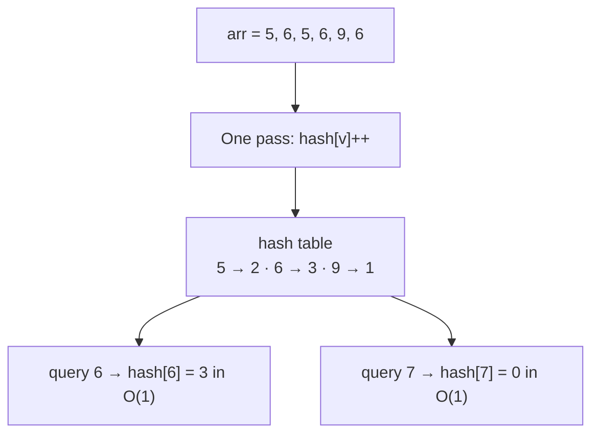

:::tip[TL;DR]
**Hashing** means doing the work **once up front** (store each element's count, index or presence in a table) so that every later question is answered in **O(1)** instead of re-scanning the input. If keys are **small integers or characters**, the table is a plain `int[]` (**number / character hashing**); if keys are big, negative, sparse or not numbers, the table is a **`HashMap`** (average O(1)) or a **`TreeMap`** (O(log n), sorted). The trade is classic: spend **O(n) extra space** to turn **O(n · q)** into **O(n + q)**.
:::

## Complexity at a Glance

| Operation | Time | Extra space | Note |
| --- | --- | --- | --- |
| Count one value by scanning | O(n) per query | O(1) | **O(n · q)** for q queries |
| Build an `int[]` frequency table (number hashing) | O(n) | **O(max − min + 1)** | Only for a small, dense value range |
| Build an `int[26]` / `int[128]` / `int[256]` (character hashing) | O(n) | **O(1)** (fixed 26 / 128 / 256) | Lowercase / ASCII / extended |
| Answer a query from an `int[]` table | **O(1)** | | Direct index |
| Build a `HashMap` frequency table | O(n) average | O(u), u = distinct values | Any `int`/`long`/`String` key; boxing cost |
| Answer a query from a `HashMap` | **O(1)** average, O(log u) worst (Java 8+) | | `getOrDefault(x, 0)` |
| Build a `TreeMap` frequency table | O(n log u) | O(u) | Keys come out **sorted** |
| Answer a query from a `TreeMap` | O(log u) | | Also floor/ceiling queries |
| Iterate all counts (array) | O(range) | | Includes the zeros |
| Iterate all counts (map) | O(u) (`HashMap`: O(capacity + u)) | | Only stored keys |

The Big-O cheat sheet for everything else is on [Time & Space Complexity](../00-complexity-analysis.md).

## Why Hashing? The Pre-computation Idea

How many times does each query value appear in `arr = {5, 6, 5, 6, 9, 6}`?



### Method 1: scan for every query

```java showLineNumbers
int[] arr = {5, 6, 5, 6, 9, 6};
int count = 0;
for (int v : arr) {
    if (v == 6) count++;
}
System.out.println(count);               // 3
```

**Time O(n) per query → O(n · q) for q queries; space O(1).**

### Method 2: pre-compute once, look up many times

```java showLineNumbers
int[] arr = {5, 6, 5, 6, 9, 6};
int[] hash = new int[10];                // index = the value, cell = how many times it appears
// highlight-next-line
for (int v : arr) hash[v]++;             // pre-computation: one pass
System.out.println(hash[6]);             // 3
System.out.println(hash[5]);             // 2
System.out.println(hash[7]);             // 0   (never seen: default value of int[] cells)
```

**Time O(n) once + O(1) per query → O(n + q); space O(max value + 1).**

| | Method 1 (scan) | Method 2 (hash) |
| --- | --- | --- |
| 1 query | O(n) | O(n) build + O(1) |
| q queries | **O(n · q)** | **O(n + q)** |
| n = q = 10⁵ | 10¹⁰ steps ❌ (too slow) | 2 × 10⁵ steps ✅ |
| Extra space | O(1) | O(range) or O(distinct) |

:::info[The pattern in one sentence]
Whenever you catch yourself answering "how many / does it exist / where is it" **repeatedly** over the same data, store the answer in a hash table first.
:::

## Number Hashing with Arrays

The array index **is** the value, so this is called **direct addressing**: the "hash function" is the identity `h(x) = x`.

### Values from 0 to max

```java title="NumberHashing.java" showLineNumbers
import java.util.Scanner;

public class NumberHashing {
    public static void main(String[] args) {
        int[] data = {1, 3, 2, 1, 3};
        int max = 12;                                    // largest value the problem allows
        // highlight-next-line
        int[] hash = new int[max + 1];                   // + 1: index max must exist
        for (int v : data) hash[v]++;

        int[] queries = {1, 4, 2, 3, 12};
        for (int q : queries) System.out.print(q + "->" + hash[q] + " ");   // 1->2 4->0 2->1 3->2 12->0
    }
}
```

**Time O(n + q); space O(max).**

### Negative values: shift by the minimum

Indexes can't be negative, so store value `v` at index `v - min`:

```java showLineNumbers
int[] nums = {-3, 2, -3, 0, 2, -3};
int min = -3, max = 2;
int[] cnt = new int[max - min + 1];          // 6 cells for the values -3..2
// highlight-next-line
for (int v : nums) cnt[v - min]++;           // -3 → index 0, 2 → index 5
cnt[-3 - min];                               // 3
cnt[2 - min];                                // 2
cnt[1 - min];                                // 0
```

**Time O(n); space O(max − min + 1).**

### How big can the array be?

| Value range | Array size | Memory for `int[]` | Verdict |
| --- | --- | --- | --- |
| 0 … 10⁵ | 10⁵ | ~400 KB | ✅ easy |
| 0 … 10⁶ | 10⁶ | ~4 MB | ✅ fine |
| 0 … 10⁷ | 10⁷ | ~40 MB | ⚠️ OK on most judges (check the memory limit) |
| 0 … 10⁹ | 10⁹ | ~4 GB | ❌ use a `HashMap` |
| any `long`, any `String` | — | — | ❌ use a `HashMap` |

:::warning[C++ advice doesn't transfer directly]
C++ tutorials say "declare big arrays globally, local arrays max ~10⁶" because local arrays live on the **stack**. In Java **every array is on the heap**, wherever you declare it, so the only limits are the heap size (`-Xmx`, set by the judge) and the maximum array length (about `Integer.MAX_VALUE - 8`). The `int[]` itself costs 4 bytes per cell (8 for `long[]`).
:::

## Character Hashing

Characters are numbers: `'a'` is 97, so `hash['a']` is just `hash[97]`.

### ASCII values worth knowing

| Characters | Codes | Index trick | Table size |
| --- | --- | --- | --- |
| `'a'` … `'z'` | 97 … 122 | `c - 'a'` → 0 … 25 | `int[26]` |
| `'A'` … `'Z'` | 65 … 90 | `c - 'A'` → 0 … 25 | `int[26]` |
| `'0'` … `'9'` | 48 … 57 | `c - '0'` → the digit | `int[10]` |
| Any ASCII (letters, digits, spaces, punctuation) | 0 … 127 | `c` itself | `int[128]` |
| Extended (Latin-1) | 0 … 255 | `c` itself | `int[256]` |
| Any Unicode | up to 0x10FFFF | code point | `HashMap<Integer, Integer>` |

Verified on JDK 21: `(int) 'a'` = 97, `(int) 'z'` = 122, `(int) 'A'` = 65, `(int) 'Z'` = 90, `(int) '0'` = 48, `'b' - 'a'` = 1, `(char) ('a' + 2)` = `c`.

### Lowercase letters only: `int[26]`

```java showLineNumbers
String s = "abcdabehf";
int[] f = new int[26];
// highlight-next-line
for (char c : s.toCharArray()) f[c - 'a']++;       // 'a' → 0, 'b' → 1, ... 'z' → 25
f['a' - 'a'];                                        // 2
f['b' - 'a'];                                        // 2
f['c' - 'a'];                                        // 1
f['z' - 'a'];                                        // 0
```

**Time O(n + q); space O(26) = O(1).** Using `'a'` as the offset is the "reduce by the minimum" trick from number hashing: it saves the 97 unused cells of an `int[123]`.

### Any ASCII character: `int[128]`

```java showLineNumbers
int[] f = new int[128];
for (char c : "Hello, World!".toCharArray()) f[c]++;   // char is used directly as an index
f['l'];                                                 // 3
f['o'];                                                 // 2
f[' '];                                                 // 1
f['H'];                                                 // 1
f['h'];                                                 // 0  (case matters: 'H' is 72, 'h' is 104)
```

**Time O(n); space O(128) = O(1).**

### Beyond ASCII: count code points

`char` is a UTF-16 unit, so emoji and some scripts take **two** `char`s. Count code points in a map:

```java showLineNumbers
Map<Integer, Integer> cp = new HashMap<>();
"naïve café".codePoints().forEach(c -> cp.merge(c, 1, Integer::sum));
cp.get((int) 'é');                                      // 1
cp.get((int) 'a');                                      // 2
```

**Time O(n) average; space O(distinct code points).**

## When the Array Won't Do: HashMap and TreeMap

| Situation | Use | Why |
| --- | --- | --- |
| Values in a small range (≤ ~10⁷) | `int[]` | Fastest, no boxing |
| Values huge (10⁹), negative and sparse, `long`s, `String`s, pairs | **`HashMap`** | Stores only the u distinct keys |
| Need the keys **sorted** (smallest/largest key, ranges) | **`TreeMap`** | O(log u) per operation |
| Need the first-seen order | `LinkedHashMap` | Insertion order |

```java showLineNumbers
int[] big = {1_000_000_000, 7, 1_000_000_000, -5};
Map<Integer, Integer> freq = new HashMap<>();
// highlight-next-line
for (int v : big) freq.merge(v, 1, Integer::sum);       // insert 1, or add 1 to the old count
freq.getOrDefault(1_000_000_000, 0);                    // 2
freq.getOrDefault(3, 0);                                // 0  (absent → default; get would return null)

Map<Integer, Integer> sorted = new TreeMap<>();
for (int v : new int[]{5, 6, 5, 6, 9, 6}) sorted.merge(v, 1, Integer::sum);
System.out.println(sorted);                             // {5=2, 6=3, 9=1}  ascending keys
```

**HashMap: O(n) build, O(1) average per query, O(u) space. TreeMap: O(n log u) build, O(log u) per query, O(u) space.**

| | `int[]` table | `HashMap` | `TreeMap` | C++ equivalent |
| --- | --- | --- | --- | --- |
| Lookup / update | O(1) | O(1) average, O(log u) worst | O(log u) always | `vector` / `unordered_map` / `map` |
| Worst case cause | — | Many keys colliding in one bucket | — | `unordered_map` worst case is O(n) (no treeification) |
| Keys | Small non-negative ints | Anything with `equals`/`hashCode` | Anything `Comparable` | |
| Ordered iteration | ✅ by index | ❌ | ✅ sorted | |
| Speed (one run, JDK 21, 5 million values in 0 … 99,999) | **5 ms** | 146 ms (~30× slower: boxing + hashing) | | |

How `HashMap` reaches O(1), and why its worst case is O(log u) in Java 8+, is on the Core Java pages [Hashing Fundamentals](../../01-core-java/04-hashing/hashing-and-hashcode.md) and [HashMap Internals](../../01-core-java/04-hashing/hashmap-internals.md). The full method reference (`merge`, `computeIfAbsent`, iteration) is on [HashSet & HashMap](../01-java-toolkit/03-collections/04-hashset-hashmap.md).

:::danger[Hidden costs in "O(1)"]
- **Boxing**: every `int` key becomes an `Integer` object (cached only for -128 … 127), ~16 bytes plus a ~32-byte map node per entry.
- **Key hashing**: a `String` key of length L costs **O(L)** to hash (once, then cached) and O(L) to compare. "Count the words" is O(total characters).
- **Iteration**: a `HashMap` iterates its whole table: O(capacity + u).
:::

## Practice Problems

### Highest Occurring Element

Return the element with the highest frequency; on a tie, the **smallest** such element.

```java title="HighestOccurring.java" showLineNumbers
static int highestOccurring(int[] nums) {
    Map<Integer, Integer> freq = new HashMap<>();
    for (int v : nums) freq.merge(v, 1, Integer::sum);

    int best = -1, bestCount = 0;
    for (Map.Entry<Integer, Integer> e : freq.entrySet()) {
        int v = e.getKey(), c = e.getValue();
        // highlight-next-line
        if (c > bestCount || (c == bestCount && v < best)) {   // higher count, or same count but smaller value
            best = v;
            bestCount = c;
        }
    }
    return best;
}
// {1, 2, 2, 3, 3, 3} → 3
// {4, 4, 5, 5, 6}    → 4   (4 and 5 both appear twice; 4 is smaller)
```

**Time O(n) average; space O(u).** Brute force (count each element with an inner loop) is **O(n²) time, O(1) space**.

### Second Highest Occurring Element

Return the element whose frequency is the **second largest distinct frequency** (smallest element on a tie), or `-1` if there isn't one.

```java title="SecondHighestOccurring.java" showLineNumbers
static int secondHighestOccurring(int[] nums) {
    Map<Integer, Integer> freq = new HashMap<>();
    for (int v : nums) freq.merge(v, 1, Integer::sum);

    int maxF = 0, secF = 0;
    for (int c : freq.values()) {
        // highlight-start
        if (c > maxF) { secF = maxF; maxF = c; }               // new maximum: old max becomes second
        else if (c > secF && c < maxF) secF = c;               // strictly between: new second
        // highlight-end
    }
    if (secF == 0) return -1;                                  // every element has the same frequency

    int ans = Integer.MAX_VALUE;
    for (Map.Entry<Integer, Integer> e : freq.entrySet())
        if (e.getValue() == secF) ans = Math.min(ans, e.getKey());
    return ans;
}
// {1, 2, 2, 3, 3, 3}        → 2    (freqs 1, 2, 3: second is 2)
// {4, 4, 5, 5}              → -1   (only one distinct frequency)
// {10, 9, 7, 7, 8, 8, 8}    → 7    (freqs 1, 1, 2, 3: second is 2)
```

**Time O(n) average (two passes over at most n distinct keys); space O(u).** Sorting the frequencies instead would be O(u log u).

### Sum of Highest and Lowest Frequency

```java title="SumHighestLowest.java" showLineNumbers
static int sumHighestLowest(int[] nums) {
    Map<Integer, Integer> freq = new HashMap<>();
    for (int v : nums) freq.merge(v, 1, Integer::sum);

    int maxF = 0, minF = Integer.MAX_VALUE;
    for (int c : freq.values()) {
        maxF = Math.max(maxF, c);
        minF = Math.min(minF, c);                              // only over elements that appear (no zeros)
    }
    return maxF + minF;
}
// {1, 2, 2, 3, 3, 3} → 3 + 1 = 4
// {4, 4, 5, 5, 6}    → 2 + 1 = 3
```

**Time O(n) average; space O(u).** If the values are small (say 0 … 10⁴), use `int[]` and **skip the zero cells** when taking the minimum, or the answer will be wrong.

## Pattern Complexity Summary

| Pattern | Time | Space |
| --- | --- | --- |
| Frequency of q values, scan each time | O(n · q) | O(1) |
| Frequency table with `int[]` (number hashing) | O(n + q) | O(range) |
| Frequency table with `int[26]` / `int[128]` (character hashing) | O(n + q) | O(1) |
| Frequency table with `HashMap` | O(n + q) average | O(u) |
| Frequency table with `TreeMap` | O((n + q) log u) | O(u) |
| Highest / second highest / sum of highest and lowest frequency | O(n) average | O(u) |

## Gotchas

- **Off-by-one in the table size**: values up to `max` need `new int[max + 1]`.
- **`f[c - 'a']` on a capital letter** gives a negative index (`'A' - 'a'` = -32) → `ArrayIndexOutOfBoundsException`. Check the input's alphabet before choosing `int[26]`.
- **`map.get(x)` for a missing key is `null`**: `int c = map.get(x);` throws `NullPointerException`. Use `getOrDefault(x, 0)`.
- **Comparing two `Integer` counts with `==`** works up to 127 (the `Integer` cache) and silently fails above it. Use `.equals` or unbox.
- **Minimum frequency from an `int[]`** must ignore the zeros (values that never appeared).
- Next: how the hash function itself works and what happens when two keys collide, on [Hash Functions & Collisions](./02-hash-functions-and-collisions.md).
