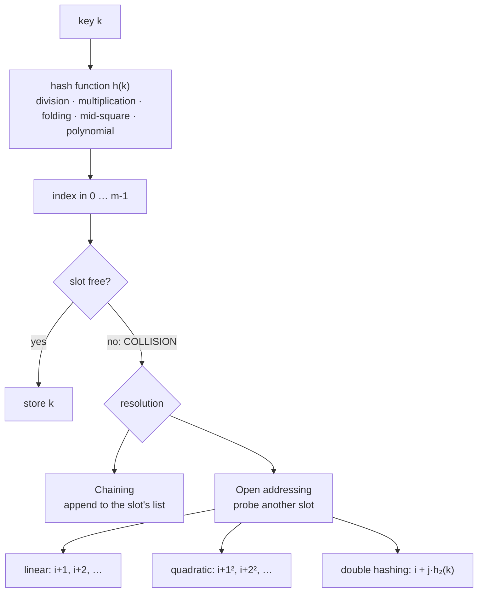

:::tip[TL;DR]
A **hash function** squeezes a key into a table index: `h(k) = k % m` (**division**), `⌊m · frac(k · A)⌋` (**multiplication**), add up chunks of the key (**folding**), or take the middle digits of `k²` (**mid-square**). Since many keys share few slots, **collisions** always happen, and a hash table is defined by how it handles them: **chaining** (a list per slot) or **open addressing** (probe for another free slot: linear, quadratic, double hashing). Keep the **load factor** low and rehash when it grows, and every operation stays **O(1) on average**, O(n) in the worst case.
:::

## Complexity at a Glance

n keys, m slots, load factor α = n / m.

| Operation | Average | Worst | Extra space | Note |
| --- | --- | --- | --- | --- |
| Compute `h(k)` for an `int` | O(1) | O(1) | O(1) | |
| Compute `h(k)` for a string of length L | O(L) | O(L) | O(1) | Cache it if the key is reused |
| Chaining: insert (at head or tail, after a duplicate check) | O(1 + α) | O(n) | O(1) per node | All keys in one chain |
| Chaining: search / delete | O(1 + α) | O(n) | | |
| Chaining with a **balanced BST** per bucket (Java 8 `HashMap`) | O(1 + α) | **O(log n)** | | |
| Open addressing: insert / search (α < 1) | O(1 / (1 − α)) | O(m) | O(1) | Blows up as α → 1 |
| Open addressing: delete | same as search | O(m) | | Needs **tombstones** |
| Rehash (double the table) | O(n) | O(n) | O(n) new table | **Amortized O(1)** per insert |
| Table memory | | | O(m + n) chaining, O(m) open addressing | |

Shared Big-O cheat sheet: [Time & Space Complexity](../00-complexity-analysis.md).

## The Big Picture



## Hash Functions

### What makes one good

| Property | Why |
| --- | --- |
| **Deterministic** | The same key must find the same slot later |
| **Uniform** | Keys spread evenly, so chains stay short |
| **Fast** | It runs on every insert and lookup |
| **Uses the whole key** | Keys that differ only in some digits/characters must still land in different slots |
| **Avalanche** (nice to have) | Similar keys (`user1`, `user2`) should land far apart |

### Division method

`h(k) = k mod m`, with `m` usually a **prime** not close to a power of 2 or 10.

Keys `{56, 75, 42, 88, 91}` with `m = 7`:

| Key | `k % 7` | Slot |
| --- | --- | --- |
| 56 | 0 | 0 |
| 75 | 5 | 5 |
| 42 | 0 | 0 (**collision** with 56) |
| 88 | 4 | 4 |
| 91 | 0 | 0 (**collision** with 56 and 42) |

Why a prime? Real keys have patterns. Keys `{10, 20, 30, 40, 50}` with `m = 10` all land in slot **0**; with `m = 7` they spread to slots **3, 6, 2, 5, 1** (verified). A modulus that shares a factor with the pattern's step collapses the keys into a few slots; a prime shares no factors with typical steps.

```java showLineNumbers
static int division(int k, int m) {
    // highlight-next-line
    return Math.floorMod(k, m);          // not k % m: that is negative for negative k
}
```

**Time O(1); space O(1).** Weakness: the modulo is a division (slower than a shift), and a bad `m` wrecks the distribution.

### Multiplication method

`h(k) = ⌊m · frac(k · A)⌋` with `0 < A < 1`; Knuth suggests `A = (√5 − 1) / 2 ≈ 0.6180339887` (the golden ratio). The size `m` doesn't need to be prime, so it's usually a power of two.

```java showLineNumbers
static final double A = (Math.sqrt(5) - 1) / 2;       // 0.6180339887498949

static int multiplication(int k, int m) {
    double frac = (k * A) % 1;                          // fractional part of k·A
    return (int) Math.floor(m * frac);
}
// keys 56, 75, 42, 88, 91 with m = 8 → slots 4, 2, 7, 3, 1   (no collisions)

// integer-only version ("Fibonacci hashing"), m = 2^p: multiply by 2^32/φ and keep the top p bits
static int fibonacci(int k, int p) {
    // highlight-next-line
    return (k * 0x9E3779B9) >>> (32 - p);
}
// same keys, p = 3 → 4, 2, 7, 3, 1
```

**Time O(1); space O(1).** Used by Java's `ThreadLocal` (its hash increment `0x61c88647` is `-0x9E3779B9`, the same golden-ratio constant) and many open-addressing tables.

### Folding method

Split the key into equal-size parts and **add** them (then reduce modulo `m`).

| Variant | Key `123456789`, 3-digit parts | Sum | `% 1000` |
| --- | --- | --- | --- |
| **Shift folding** | 123 + 456 + 789 | 1368 | **368** |
| **Boundary folding** (reverse every other part) | 123 + **654** + 789 | 1566 | **566** |

Good for long keys like phone numbers, account numbers or IDs, where every digit should influence the slot. If the key doesn't split evenly, the last part is shorter (or padded).

### Mid-square method

Square the key and take the **middle** digits (or bits). The middle of `k²` depends on **all** digits of `k`, so similar keys spread out.

| Key | k² | Middle digits | Table size |
| --- | --- | --- | --- |
| 3121 | 9740641 | **406** | 1000 |
| 56 | 3136 | **13** | 100 |

Weakness: squaring large keys overflows (use `long`), and keys with many trailing zeros give poor middles.

### Strings: polynomial hashing

Treat the string as a number in base `B`:

`h(s) = (s₀·B^(n−1) + s₁·B^(n−2) + … + s_(n−1)) mod M`, computed left to right as `h = (h·B + c) mod M`.

```java showLineNumbers
static long polyHash(String s) {
    final long B = 31, M = 1_000_000_007L;
    long h = 0;
    for (char c : s.toCharArray()) {
        // highlight-next-line
        h = (h * B + (c - 'a' + 1)) % M;      // map 'a' → 1 (not 0, or "a" and "aa" would both hash to 0)
    }
    return h;
}
// polyHash("cat") = (3·31 + 1)·31 + 20 = 2934
```

**Time O(L); space O(1).** Java's own `String.hashCode()` is this formula with `B = 31`, the raw `char` values, and `M = 2³²` (int overflow). The same idea powers **Rabin–Karp** substring search: see [Hashing Problem Patterns](./03-hashing-patterns.md#rabinkarp-rolling-hash-substring-search).

### Comparing the methods

| Method | Formula | Table size | Strength | Weakness |
| --- | --- | --- | --- | --- |
| Division | `k mod m` | prime | Simplest, fast enough | Sensitive to `m` |
| Multiplication | `⌊m·frac(kA)⌋` | power of 2 | `m` can be anything; integer version is a multiply and a shift | Slightly more work |
| Folding | sum of chunks | any | Long numeric keys | Order-insensitive in shift folding (123456 and 456123 collide) |
| Mid-square | middle of `k²` | power of 10 / 2 | All digits matter | Overflow, small keys |
| Polynomial | `Σ sᵢ·B^(n−1−i) mod M` | any | Strings, rolling updates | O(L) per key |
| Universal hashing | `((a·k + b) mod p) mod m`, random `a, b` | any | No fixed bad input exists (defends against attacks) | Needs randomness |

## Collisions

**Pigeonhole principle**: with more possible keys than slots, two keys **must** share a slot. Even with few keys, collisions come early (**birthday paradox**: 23 people, 365 days → over 50% chance of a shared birthday). So the question is never "how to avoid collisions" but "how to handle them".

### Separate chaining

Each slot holds a **list** of all keys that hash there.

Keys `{56, 75, 42, 88, 91}`, `m = 7`, inserted in that order:

| Slot | Chain |
| --- | --- |
| 0 | 56 → 42 → 91 |
| 1–3 | empty |
| 4 | 88 |
| 5 | 75 |
| 6 | empty |

- **Insert**: compute the slot, check the chain for the key (update if found), else append. Order inside a chain doesn't matter for correctness; it's just insertion order. Keeping chains **sorted** would make inserts slower and gives no average-case benefit.
- **Search 91**: slot `91 % 7 = 0` → compare 56, 42, 91 → found after 3 comparisons. A key that isn't there stops at the end of **its** chain; no other slot is ever checked.
- **Delete**: unlink the node. Nothing else changes.
- **Can I binary search a chain?** Not a linked list (no O(1) access to the middle). A **sorted array** per slot allows O(log k) search but O(k) insertion; a **balanced BST** per slot gives O(log k) for both, which is exactly what Java 8's `HashMap` does once a chain reaches 8 nodes.

### Open addressing

All keys live **inside the array**. On a collision, try other slots in a fixed **probe sequence** until a free one appears. Search follows the same sequence and stops at the key or at an **empty** slot.

Same keys, `m = 7`, verified by running each scheme:

| Scheme | Probe sequence (attempt j = 0, 1, 2 …) | Probes for 42 | Probes for 91 | Final table (slots 0–6) |
| --- | --- | --- | --- | --- |
| **Linear** | `(h + j) mod m` | 0 → **1** | 0 → 1 → **2** | 56, 42, 91, _, 88, 75, _ |
| **Quadratic** | `(h + j²) mod m` | 0 → **1** | 0 → 1 → 4 → **2** | 56, 42, 91, _, 88, 75, _ |
| **Double hashing**, `h₂(k) = 5 − (k mod 5)` | `(h + j·h₂(k)) mod m` | 0 → **3** (step 3) | 0 → 4 → **1** (step 4) | 56, 91, _, 42, 88, 75, _ |

| Scheme | Clustering | Notes |
| --- | --- | --- |
| Linear probing | **Primary clustering**: occupied runs grow and merge, so new keys landing anywhere in a run extend it | Best cache locality; very fast at low α. Used by `IdentityHashMap`, `Map.of`, Python dicts (perturbed) |
| Quadratic probing | **Secondary clustering**: keys with the same home slot follow the same path | May fail to find a free slot unless `m` is prime and α ≤ ½ |
| Double hashing | Almost none: the step depends on the key | `h₂(k)` must never be 0 and should be coprime with `m` |

### Deleting in open addressing: tombstones

You **can't** just empty the slot: a later search would stop at that hole and miss keys stored further along the probe sequence. Mark it **DELETED** (a tombstone): searches skip over it, inserts may reuse it.

```text
keys 56, 88, 72, 104, 75 in a table of 16 (home slot = k % 16; 56, 88, 72, 104 all have home 8)
before:           [_ _ _ _ _ _ _ _ 56 88 72 104 75 _ _ _]
remove(88):       [_ _ _ _ _ _ _ _ 56  X 72 104 75 _ _ _]   X = tombstone
contains(104)  → slots 8, 9 (X: keep going), 10, 11 → true
(if slot 9 had been emptied, the search would stop at 9 and wrongly return false)
add(40) (home 8) → reuses the tombstone at slot 9
```

Too many tombstones slow every search down, so implementations **rebuild** the table once tombstones pile up.

### Chaining vs open addressing

| | Chaining | Open addressing |
| --- | --- | --- |
| Load factor α | Can exceed 1 | Must stay < 1 (typically ≤ 0.5–0.7) |
| Expected probes, unsuccessful search | 1 + α | ≈ ½ (1 + 1 / (1 − α)²) for linear probing |
| Expected probes, successful search | ≈ 1 + α / 2 | ≈ ½ (1 + 1 / (1 − α)) for linear probing |
| Memory | Array + one node per key (pointer overhead) | Array only |
| Cache behaviour | Pointer chasing | Contiguous: CPU-cache friendly |
| Delete | Easy | Tombstones |
| Sensitivity to a bad hash | Long chains (Java: treeify) | Clusters, then everything slows |
| In Java | `HashMap`, `HashSet`, `ConcurrentHashMap`, `Hashtable` | `IdentityHashMap`, `ThreadLocalMap`, `Map.of`/`Set.of` |

With linear probing at α = 0.5, an unsuccessful search costs about 2.5 probes; at α = 0.9 about 50.5. That cliff is why open-addressing tables resize early.

### Load factor and rehashing

- **α = n / m**. As α grows, chains lengthen (chaining) or probe sequences lengthen (open addressing).
- **Rehash**: when α passes a limit (Java `HashMap`: 0.75), allocate a table about **twice** as big and re-insert every key with the new `m` (indexes change because `m` changed).
- One rehash is O(n), but it happens after n/2 cheap inserts, so the **amortized** cost per insert stays **O(1)** (the same argument as `ArrayList` growth).

## Build Your Own

### `MyHashMap` with chaining (LeetCode 706)

```java title="MyHashMap.java" showLineNumbers
import java.util.LinkedList;

public class MyHashMap {
    private static final class Entry {
        final int key;
        int value;
        Entry(int key, int value) { this.key = key; this.value = value; }
    }

    private LinkedList<Entry>[] buckets;
    private int size;
    private static final double MAX_LOAD = 0.75;

    @SuppressWarnings("unchecked")
    public MyHashMap() { buckets = new LinkedList[16]; }

    private int index(int key, int m) {
        // highlight-next-line
        return Math.floorMod(Integer.hashCode(key), m);       // division method, never negative
    }

    public void put(int key, int value) {
        int i = index(key, buckets.length);
        if (buckets[i] == null) buckets[i] = new LinkedList<>();
        for (Entry e : buckets[i]) {
            if (e.key == key) { e.value = value; return; }    // existing key: update in place
        }
        buckets[i].add(new Entry(key, value));                // new key: append to the chain
        size++;
        // highlight-next-line
        if ((double) size / buckets.length > MAX_LOAD) rehash();
    }

    public int get(int key) {
        LinkedList<Entry> b = buckets[index(key, buckets.length)];
        if (b != null) for (Entry e : b) if (e.key == key) return e.value;
        return -1;                                            // LeetCode's "not found"
    }

    public void remove(int key) {
        LinkedList<Entry> b = buckets[index(key, buckets.length)];
        if (b != null && b.removeIf(e -> e.key == key)) size--;
    }

    @SuppressWarnings("unchecked")
    private void rehash() {
        LinkedList<Entry>[] old = buckets;
        buckets = new LinkedList[old.length * 2];
        for (LinkedList<Entry> b : old) {
            if (b == null) continue;
            for (Entry e : b) {                               // every key gets a NEW index (m changed)
                int i = index(e.key, buckets.length);
                if (buckets[i] == null) buckets[i] = new LinkedList<>();
                buckets[i].add(e);
            }
        }
    }
}
```

```java title="Using it"
MyHashMap m = new MyHashMap();
m.put(1, 1); m.put(2, 2);
m.get(1);        // 1
m.get(3);        // -1
m.put(2, 1);     // update
m.get(2);        // 1
m.remove(2);
m.get(2);        // -1
m.put(-7, 70);   // negative keys work (floorMod)
m.get(-7);       // 70
// after 23 distinct keys: capacity grew 16 → 32 (23 / 16 > 0.75)
```

**Time: O(1) average per operation, O(n) worst (one chain); rehash O(n), amortized O(1). Space: O(m + n).** The brute-force alternative (a `List` of pairs) is O(n) per operation; a direct-address `int[1_000_001]` (keys are 0 … 10⁶ on LeetCode) is O(1) but always uses ~4 MB.

### A set with open addressing (linear probing + tombstones)

```java title="LinearProbingSet.java" showLineNumbers
import java.util.Arrays;

public class LinearProbingSet {
    private static final int EMPTY = Integer.MIN_VALUE;        // sentinels: these two values can't be stored
    private static final int DELETED = Integer.MIN_VALUE + 1;
    private int[] slots;
    private int size, used;                                    // used = live keys + tombstones

    public LinearProbingSet(int capacity) {
        slots = new int[capacity];
        Arrays.fill(slots, EMPTY);
    }

    private int home(int key) { return Math.floorMod(key, slots.length); }

    public boolean contains(int key) {
        for (int i = home(key), n = 0; n < slots.length; i = (i + 1) % slots.length, n++) {
            // highlight-next-line
            if (slots[i] == EMPTY) return false;                // a truly empty slot ends the search
            if (slots[i] == key) return true;                   // DELETED: just keep probing
        }
        return false;
    }

    public boolean add(int key) {
        if (contains(key)) return false;
        if (used + 1 > slots.length / 2) grow();                // keep α ≤ 0.5
        int i = home(key);
        while (slots[i] != EMPTY && slots[i] != DELETED) i = (i + 1) % slots.length;
        if (slots[i] == EMPTY) used++;                          // reusing a tombstone doesn't raise "used"
        slots[i] = key;
        size++;
        return true;
    }

    public boolean remove(int key) {
        for (int i = home(key), n = 0; n < slots.length; i = (i + 1) % slots.length, n++) {
            if (slots[i] == EMPTY) return false;
            // highlight-next-line
            if (slots[i] == key) { slots[i] = DELETED; size--; return true; }   // tombstone, not EMPTY
        }
        return false;
    }

    private void grow() {                                       // rebuild: also clears all tombstones
        int[] old = slots;
        slots = new int[old.length * 2];
        Arrays.fill(slots, EMPTY);
        size = 0; used = 0;
        for (int k : old) if (k != EMPTY && k != DELETED) add(k);
    }
}
// add 56, 88, 72, 104, 75 (capacity 16) → [_ _ _ _ _ _ _ _ 56 88 72 104 75 _ _ _]
// remove(88)                            → [_ _ _ _ _ _ _ _ 56 X 72 104 75 _ _ _]
// contains(104) true, contains(88) false, add(104) false, add(40) true → 40 reuses slot 9
```

**Time: O(1 / (1 − α)) expected per operation, O(m) worst; rebuild O(m). Space: O(m), no per-key objects.**

## Beyond the Hash Table

### Consistent hashing (sharding, caches, load balancers)

`server = hash(key) % N` reshuffles almost every key when `N` changes. **Consistent hashing** puts servers and keys on a **ring** of hash values; a key belongs to the first server clockwise. Adding or removing a server only moves the keys of one arc. **Virtual nodes** (each server placed many times) even out the load.

```java title="ConsistentHashRing.java" showLineNumbers
import java.util.*;

public class ConsistentHashRing {
    private final TreeMap<Integer, String> ring = new TreeMap<>();   // position on the ring → server
    private final int virtualNodes;

    public ConsistentHashRing(int virtualNodes) { this.virtualNodes = virtualNodes; }

    static int hash(String s) {                                      // String.hashCode + a bit mixer
        int h = s.hashCode();
        h ^= (h >>> 16); h *= 0x85ebca6b;
        h ^= (h >>> 13); h *= 0xc2b2ae35;
        h ^= (h >>> 16);
        return h;
    }

    public void addServer(String server) {
        for (int v = 0; v < virtualNodes; v++) ring.put(hash(server + "#" + v), server);
    }

    public void removeServer(String server) {
        for (int v = 0; v < virtualNodes; v++) ring.remove(hash(server + "#" + v));
    }

    public String serverFor(String key) {
        // highlight-next-line
        Map.Entry<Integer, String> e = ring.ceilingEntry(hash(key));   // first server clockwise
        return (e != null ? e : ring.firstEntry()).getValue();          // wrap around the ring
    }
}
```

Measured on JDK 21 with 100,000 keys and 100 virtual nodes per server, going from 3 servers (A, B, C) to 4:

| Strategy | Keys that moved | Ideal |
| --- | --- | --- |
| `hash % N` (3 → 4) | **75,120** (75%) | |
| Consistent hashing ring | **21,997** (22%), all of them to the new server D | 25% |

**`serverFor`: O(log (N · V)) time with a `TreeMap` of N servers × V virtual nodes; space O(N · V).** Used by Cassandra, DynamoDB, Memcached clients and load balancers.

### Cryptographic hashes, in one table

| | Hash table function | Cryptographic hash (SHA-256) |
| --- | --- | --- |
| Goal | Spread keys over slots, fast | Infeasible to reverse or to find collisions |
| Output | An index (32 bits or fewer) | 256 bits |
| Collisions | Expected and handled | Must be practically impossible |
| Uses | `HashMap`, sets, caches | Checksums, digital signatures, Git object ids, blockchain, password storage (with salt and a slow KDF) |

## Pattern Complexity Summary

| Technique | Time per operation | Space |
| --- | --- | --- |
| Division / multiplication / folding / mid-square hash of an `int` | O(1) | O(1) |
| Polynomial hash of a string | O(L) | O(1) |
| Chaining (list per slot) | O(1 + α) average, O(n) worst | O(m + n) |
| Chaining with a tree per slot | O(1 + α) average, O(log n) worst | O(m + n) |
| Linear probing | O(1 / (1 − α)) expected, O(m) worst | O(m) |
| Rehash / grow | O(n), amortized O(1) per insert | O(n) |
| Consistent hashing lookup (`TreeMap` ring) | O(log (N · V)) | O(N · V) |

## Gotchas

- **`k % m` is negative for negative `k`** in Java: use `Math.floorMod(k, m)`, or `k & (m - 1)` when `m` is a power of two.
- **Rehashing changes every index**: with `% m`, a key's slot depends on `m`, so all keys must be re-inserted (Java's power-of-two trick limits that to "stay or move by old m").
- **Open addressing must never be 100% full**: a search for a missing key would loop forever. Always grow before α reaches 1 (usually at 0.5–0.75).
- **Quadratic probing can miss free slots** when `m` isn't prime or α > ½.
- **Sentinel values** (`EMPTY`, `DELETED`) can't be stored as keys; use a parallel `byte[] state` array if every `int` must be allowed.
- **Order inside a chain is irrelevant to correctness**; don't waste time sorting chains in an interview unless asked.
- Next: the problem patterns that use all this, on [Hashing Problem Patterns](./03-hashing-patterns.md).
