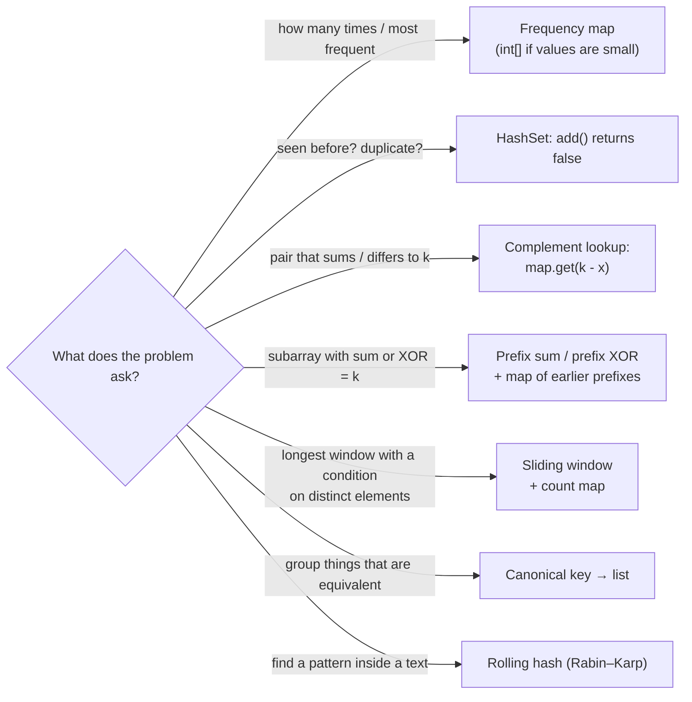

:::tip[TL;DR]
Most "can you do better than O(n²)?" interview questions are answered by **remembering what you've already seen** in a `HashSet` or `HashMap`. Six shapes cover almost all of them: **frequency count**, **seen-before set**, **complement lookup** (Two Sum), **prefix sum / prefix XOR + map**, **sliding window + count map**, and **canonical key grouping**. Two hash ideas go further: **rolling hashes** (Rabin–Karp substring search) and **Bloom filters** (a set that uses bits instead of keys). Each trades **O(n) memory** for a drop from O(n²) to **O(n)**.
:::

## Complexity at a Glance

| Pattern | Brute force | With hashing | Extra space |
| --- | --- | --- | --- |
| Frequency count / most frequent | O(n²) | **O(n)** | O(u) distinct values |
| Contains duplicate / first repeating | O(n²) | **O(n)** | O(n) |
| Two Sum / pairs with difference k | O(n²) | **O(n)** | O(n) |
| Longest consecutive sequence | O(n log n) (sort) | **O(n)** | O(n) |
| Longest subarray with sum k (negatives allowed) | O(n²) | **O(n)** | O(n) |
| Count subarrays with sum k / XOR k | O(n²) | **O(n)** | O(n) |
| Duplicate within distance k | O(n · k) | **O(n)** | O(k) |
| Longest substring with ≤ k distinct chars | O(n²) | **O(n)** | O(k) |
| 4Sum II (count tuples from 4 arrays) | O(n⁴) | **O(n²)** | O(n²) |
| Substring search (Rabin–Karp) | O(n · m) | **O(n + m)** expected | O(1) |
| Membership for huge sets (Bloom filter) | O(n) memory for keys | O(k) per query | **m bits** |

All "O(1)" map operations above are **average** case; hashing a `String` key of length L costs O(L). See [Hashing Basics](./01-hashing-basics.md) and [Hash Functions & Collisions](./02-hash-functions-and-collisions.md) for why.

## Which Pattern?



Already solved elsewhere on the site (not repeated here):

| Problem | Pattern | Where |
| --- | --- | --- |
| Two Sum | Complement lookup | [HashSet & HashMap](../01-java-toolkit/03-collections/04-hashset-hashmap.md#two-sum-value--index) |
| Group Anagrams | Canonical key | [HashSet & HashMap](../01-java-toolkit/03-collections/04-hashset-hashmap.md#group-anagrams-key--list) |
| Subarray Sum Equals K (count) | Prefix sum + count map | [HashSet & HashMap](../01-java-toolkit/03-collections/04-hashset-hashmap.md#subarray-sum-equals-k-prefix-sum--count) |
| LRU cache | `LinkedHashMap` | [HashSet & HashMap](../01-java-toolkit/03-collections/04-hashset-hashmap.md#lru-cache-in-6-lines) |
| Valid Anagram, Isomorphic Strings, Sort Characters by Frequency | Character hashing | [String Problem Playbook](../01-java-toolkit/02-arrays-and-strings/03-string-problem-playbook.md) |
| Longest substring without repeating characters | Sliding window + last-seen index | [Strings & Characters](../01-java-toolkit/02-arrays-and-strings/02-strings-and-characters.md) |
| Highest / second highest occurring element | Frequency map | [Hashing Basics](./01-hashing-basics.md#practice-problems) |

## Pattern 1: Frequency, Then a Second Pass

### First repeating and first unique element

Count everything in one pass, then scan the **original array** (not the map) so "first" means first by position.

```java showLineNumbers
static int firstRepeating(int[] nums) {
    Map<Integer, Integer> freq = new HashMap<>();
    for (int v : nums) freq.merge(v, 1, Integer::sum);
    // highlight-next-line
    for (int v : nums) if (freq.get(v) > 1) return v;      // array order, not map order
    return -1;
}
// {10, 5, 3, 4, 3, 5, 6} → 5   (5 at index 1 is the earliest element that repeats)

static int firstUnique(int[] nums) {
    Map<Integer, Integer> freq = new HashMap<>();
    for (int v : nums) freq.merge(v, 1, Integer::sum);
    for (int v : nums) if (freq.get(v) == 1) return v;
    return -1;
}
// {9, 4, 9, 6, 7, 4} → 6
```

**Time O(n) average; space O(u).** Brute force (inner loop counting each element): **O(n²) time, O(1) space**.

## Pattern 2: Seen-Before Set

### Longest consecutive sequence

Put everything in a set; only start counting from numbers that **begin** a run (`v - 1` absent), so each number is visited at most twice.

```java showLineNumbers
static int longestConsecutive(int[] nums) {
    Set<Integer> set = new HashSet<>();
    for (int v : nums) set.add(v);
    int best = 0;
    for (int v : set) {
        // highlight-next-line
        if (set.contains(v - 1)) continue;                   // not the start of a run: skip
        int len = 1;
        while (set.contains(v + len)) len++;                 // walk the run upward
        best = Math.max(best, len);
    }
    return best;
}
// {100, 4, 200, 1, 3, 2}          → 4   (1, 2, 3, 4)
// {0, 3, 7, 2, 5, 8, 4, 6, 0, 1}  → 9   (0 … 8)
```

**Time O(n) average (the inner `while` runs only from run starts, n steps in total); space O(n).** Sorting first is O(n log n) time, O(1)–O(n) space.

### Duplicate within distance k (sliding window set)

Keep a set of only the last `k` elements.

```java showLineNumbers
static boolean containsNearbyDuplicate(int[] nums, int k) {
    Set<Integer> window = new HashSet<>();
    for (int i = 0; i < nums.length; i++) {
        // highlight-next-line
        if (!window.add(nums[i])) return true;               // already in the last k elements
        if (window.size() > k) window.remove(nums[i - k]);   // slide: drop the element that left
    }
    return false;
}
// {1, 2, 3, 1}, k = 3        → true   (the two 1s are 3 apart)
// {1, 2, 3, 1, 2, 3}, k = 2  → false
```

**Time O(n) average; space O(k).** Brute force compares each element with the next k: **O(n · k)**.

## Pattern 3: Complement Lookup

### Count pairs with difference k

For each value, ask the map how many **earlier** values are `v - k` or `v + k`, then add `v`.

```java showLineNumbers
static int countPairsWithDiff(int[] nums, int k) {
    Map<Integer, Integer> freq = new HashMap<>();
    int count = 0;
    for (int v : nums) {
        // highlight-next-line
        count += freq.getOrDefault(v - k, 0) + (k != 0 ? freq.getOrDefault(v + k, 0) : 0);
        freq.merge(v, 1, Integer::sum);                       // add AFTER counting: no self-pairs
    }
    return count;
}
// {1, 5, 3, 4, 2}, k = 3  → 2   (1,4) and (5,2)
// {1, 1, 1}, k = 0        → 3   every pair of equal values
```

**Time O(n) average; space O(u).** Brute force over all pairs: **O(n²)**. Sort + two pointers: O(n log n).

### 4Sum II: meet in the middle

Count tuples `(i, j, k, l)` with `A[i] + B[j] + C[k] + D[l] == 0`. Store every `A + B` sum, then look up `-(C + D)`.

```java showLineNumbers
static int fourSumCount(int[] a, int[] b, int[] c, int[] d) {
    Map<Integer, Integer> pairSums = new HashMap<>();
    for (int x : a) for (int y : b) pairSums.merge(x + y, 1, Integer::sum);
    int count = 0;
    // highlight-next-line
    for (int x : c) for (int y : d) count += pairSums.getOrDefault(-(x + y), 0);
    return count;
}
// A = {1, 2}, B = {-2, -1}, C = {-1, 2}, D = {0, 2} → 2
```

**Time O(n²) average; space O(n²).** Brute force over all four arrays: **O(n⁴)**.

## Pattern 4: Prefix Sum / Prefix XOR + Map

The sum of `nums[j+1 … i]` is `prefix[i] - prefix[j]`. So "a subarray ending at `i` sums to `k`" means "some earlier prefix equals `prefix[i] - k`": a map lookup.

| Question | Store in the map | Seed |
| --- | --- | --- |
| **Count** subarrays with sum k | prefix → how many times seen | `{0: 1}` |
| **Longest** subarray with sum k | prefix → **first** index seen | `{0: -1}` |
| **Count** subarrays with XOR k | prefix XOR → how many times seen | `{0: 1}` |
| Longest subarray with equal 0s and 1s | treat 0 as -1, then "longest with sum 0" | `{0: -1}` |

### Longest subarray with sum k (negatives allowed)

```java showLineNumbers
static int longestSubarraySumK(int[] nums, int k) {
    Map<Long, Integer> firstIndex = new HashMap<>();
    // highlight-next-line
    firstIndex.put(0L, -1);                                  // empty prefix "ends" before index 0
    long sum = 0;                                            // long: prefix sums can overflow int
    int best = 0;
    for (int i = 0; i < nums.length; i++) {
        sum += nums[i];
        Integer j = firstIndex.get(sum - k);
        if (j != null) best = Math.max(best, i - j);         // subarray j+1 … i sums to k
        // highlight-next-line
        firstIndex.putIfAbsent(sum, i);                      // keep the EARLIEST index: longest window
    }
    return best;
}
// {1, 2, 3, 1, 1, 1, 1, 4, 2, 3}, k = 3  → 3   (1, 1, 1)
// {2, -1, 3, -2, 1, 1}, k = 2            → 5   (-1, 3, -2, 1, 1)
// {-1, 1, 1}, k = 1                      → 3
```

**Time O(n) average; space O(n).** Brute force over all subarrays with a running sum: **O(n²)**. If all numbers are **non-negative**, a sliding window does it in O(n) time and **O(1)** space; with negatives, only the prefix map works.

### Count subarrays with XOR k

XOR has the same "undo" property as subtraction: `prefix[i] ^ prefix[j]` is the XOR of `nums[j+1 … i]`, so look up `prefix ^ k`.

```java showLineNumbers
static int countXorK(int[] nums, int k) {
    Map<Integer, Integer> seen = new HashMap<>();
    seen.put(0, 1);                                          // the empty prefix
    int xr = 0, count = 0;
    for (int v : nums) {
        xr ^= v;
        // highlight-next-line
        count += seen.getOrDefault(xr ^ k, 0);               // earlier prefixes p with p ^ xr == k
        seen.merge(xr, 1, Integer::sum);
    }
    return count;
}
// {4, 2, 2, 6, 4}, k = 6  → 4
// {5, 6, 7, 8, 9}, k = 5  → 2
```

**Time O(n) average; space O(n).** Brute force: **O(n²)**.

## Pattern 5: Sliding Window + Count Map

### Longest substring with at most k distinct characters

Grow the window on the right; when it has more than `k` distinct characters, shrink from the left. `map.size()` **is** the number of distinct characters, provided counts that reach zero are removed.

```java showLineNumbers
static int longestKDistinct(String s, int k) {
    Map<Character, Integer> cnt = new HashMap<>();
    int best = 0, left = 0;
    for (int r = 0; r < s.length(); r++) {
        cnt.merge(s.charAt(r), 1, Integer::sum);
        while (cnt.size() > k) {
            // highlight-next-line
            cnt.merge(s.charAt(left), -1, (o, d) -> o + d == 0 ? null : o + d);   // null → key removed
            left++;
        }
        best = Math.max(best, r - left + 1);
    }
    return best;
}
// "eceba", k = 2   → 3   ("ece")
// "aabbcc", k = 1  → 2
```

**Time O(n) average (each index enters and leaves the window once); space O(k).** Brute force over all substrings: **O(n²)** with an incremental distinct count. For lowercase-only input, an `int[26]` plus a `distinct` counter is faster.

## Pattern 6: Two-Way Mapping (Bijection)

### Word Pattern

`"abba"` matches `"dog cat cat dog"`: each letter maps to one word **and** each word to one letter. One map isn't enough (`"abba"` vs `"dog dog dog dog"` passes a one-way check).

```java showLineNumbers
static boolean wordPattern(String pattern, String s) {
    String[] words = s.split(" ");
    if (words.length != pattern.length()) return false;
    Map<Character, String> p2w = new HashMap<>();
    Map<String, Character> w2p = new HashMap<>();
    for (int i = 0; i < words.length; i++) {
        char c = pattern.charAt(i);
        String w = words[i];
        // highlight-next-line
        if (!w.equals(p2w.getOrDefault(c, w)) || c != w2p.getOrDefault(w, c)) return false;
        p2w.put(c, w);
        w2p.put(w, c);
    }
    return true;
}
// "abba", "dog cat cat dog"  → true
// "abba", "dog dog dog dog"  → false   (w2p catches 'b' → "dog" already taken by 'a')
```

**Time O(total characters) (string keys hash in O(L)); space O(distinct words).** The same two-map idea solves Isomorphic Strings ([String Problem Playbook](../01-java-toolkit/02-arrays-and-strings/03-string-problem-playbook.md#isomorphic-strings)).

## Rabin–Karp: Rolling Hash Substring Search

Compare **hashes** of each length-m window of the text with the pattern's hash; only when they match, compare characters. The trick is **rolling** the window hash in O(1): remove the outgoing character's contribution, shift, add the incoming character.

`hash(window) = (c₀·B^(m−1) + c₁·B^(m−2) + … + c_(m−1)) mod M`, so sliding one step is `((h − c_out·B^(m−1))·B + c_in) mod M`.

```java title="RabinKarp.java" showLineNumbers
static List<Integer> rabinKarp(String text, String pat) {
    final long B = 256, M = 1_000_000_007L;
    int n = text.length(), m = pat.length();
    List<Integer> hits = new ArrayList<>();
    if (m > n) return hits;

    long power = 1;                                            // B^(m-1) mod M
    for (int i = 1; i < m; i++) power = power * B % M;

    long hp = 0, ht = 0;                                       // pattern hash, first window hash
    for (int i = 0; i < m; i++) {
        hp = (hp * B + pat.charAt(i)) % M;
        ht = (ht * B + text.charAt(i)) % M;
    }
    for (int i = 0; ; i++) {
        // highlight-next-line
        if (hp == ht && text.regionMatches(i, pat, 0, m)) hits.add(i);   // verify: hashes can collide
        if (i + m == n) break;
        ht = (ht - text.charAt(i) * power % M + M) % M;        // drop the outgoing char (+ M keeps it ≥ 0)
        ht = (ht * B + text.charAt(i + m)) % M;                // shift and add the incoming char
    }
    return hits;
}
// rabinKarp("abracadabra", "abra") → [0, 7]
// rabinKarp("aaaaa", "aa")         → [0, 1, 2, 3]
```

**Time O(n + m) expected, O(n · m) worst (every window collides, e.g. adversarial input); space O(1).** Naive search compares every window: **O(n · m)**. Rolling hashes also solve "longest duplicate substring" (binary search on the length + a set of window hashes) and "count distinct substrings".

:::warning[Always confirm a hash match]
Equal hashes don't prove equal strings (a collision). Skipping the `regionMatches` check turns Rabin–Karp into a probabilistic algorithm that can return wrong indexes. With one 64-bit or two independent moduli, collisions are rare enough that competitive programmers sometimes skip it, but in an interview say why you verify.
:::

## Bloom Filter: a Set Made of Bits

A **Bloom filter** answers "is x in the set?" with **"definitely not"** or **"probably yes"**, using only `m` bits and `k` hash functions: `add` sets `k` bits, `mightContain` checks that all `k` are set. No false negatives, a tunable rate of false positives, and it can't list or delete its elements.

```java title="BloomFilter.java" showLineNumbers
import java.util.BitSet;

public class BloomFilter {
    private final BitSet bits;
    private final int m, k;

    public BloomFilter(int m, int k) { this.bits = new BitSet(m); this.m = m; this.k = k; }

    private int index(String s, int i) {                      // k hash functions from two (double hashing)
        int h1 = s.hashCode();
        int h2 = (h1 >>> 16) | 1;
        int h = h1 * 0x9E3779B9 + i * (h2 * 0x85ebca6b);
        return Math.floorMod(h, m);
    }

    public void add(String s) {
        for (int i = 0; i < k; i++) bits.set(index(s, i));
    }

    public boolean mightContain(String s) {
        // highlight-next-line
        for (int i = 0; i < k; i++) if (!bits.get(index(s, i))) return false;   // one clear bit → definitely absent
        return true;                                                            // all set → probably present
    }
}
// m = 10,000 bits, k = 3, 1,000 names added:
//   false negatives 0; false positives 1,216 of 100,000 other names (1.2%)
//   theory (1 − e^(−kn/m))^k = 1.7%
```

**Time O(k) per operation; space m bits** (here 10,000 bits ≈ 1.2 KB for 1,000 strings, versus storing every string plus a map node per element in a `HashSet<String>`). Used by databases (Cassandra, RocksDB, HBase skip disk reads for absent keys), CDNs, spell checkers and "has this URL been crawled?" checks. Guava ships a production version (`BloomFilter.create(...)`).

## Pattern Complexity Summary

| Pattern | Example problems | Time | Space |
| --- | --- | --- | --- |
| Frequency + second pass | First repeating / first unique, majority element | O(n) | O(u) |
| Seen-before set | Contains duplicate, longest consecutive sequence | O(n) | O(n) |
| Window set | Duplicate within distance k | O(n) | O(k) |
| Complement lookup | Two Sum, pairs with difference k | O(n) | O(n) |
| Meet in the middle | 4Sum II | O(n²) | O(n²) |
| Prefix sum + map | Subarray sum = k (count / longest), equal 0s and 1s | O(n) | O(n) |
| Prefix XOR + map | Count subarrays with XOR k | O(n) | O(n) |
| Sliding window + count map | Longest substring with ≤ k distinct, minimum window substring | O(n) | O(alphabet) |
| Two-way mapping | Word pattern, isomorphic strings | O(n) | O(u) |
| Canonical key grouping | Group anagrams, group shifted strings | O(n · key cost) | O(n · k) |
| Rolling hash | Rabin–Karp, longest duplicate substring | O(n + m) expected | O(1) |
| Bloom filter | Membership with tiny memory | O(k) per query | m bits |

## Gotchas

- **Add to the map after the lookup** in complement and prefix patterns, or an element pairs with itself (`k = 0` cases, `nums[i] * 2 == target`).
- **Seed the prefix map** with `{0: 1}` (counting) or `{0: -1}` (longest); forgetting it misses subarrays that start at index 0.
- **Longest vs count**: for "longest" keep the **first** index (`putIfAbsent`); for "count" keep **how many** times each prefix appeared.
- **Prefix sums overflow** `int` for n = 10⁵ values of 10⁹: use `long` (and `Map<Long, …>`, since `map.get(intValue)` on a `Map<Long, …>` boxes to `Integer` and never matches).
- **Sliding windows with a map**: remove keys whose count reaches 0, otherwise `map.size()` stops meaning "distinct elements in the window".
- **`HashMap` iteration order is not "first seen"**: to find the first element with a property, re-scan the input (or use a `LinkedHashMap`).
- **Hash collisions in rolling hashes**: always verify, or use double hashing (two moduli) when you can't afford the check.
